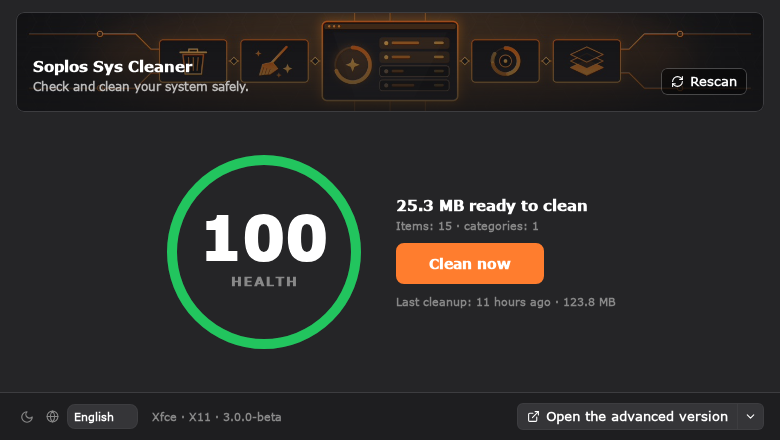
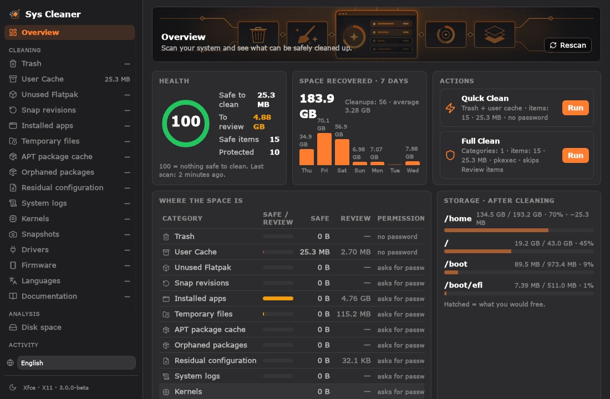
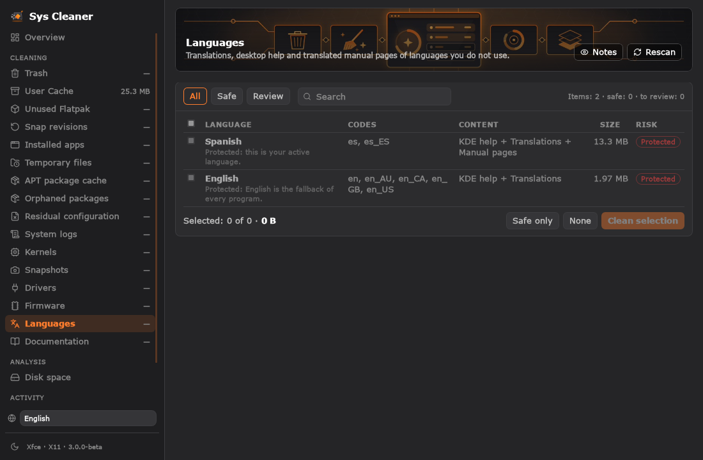
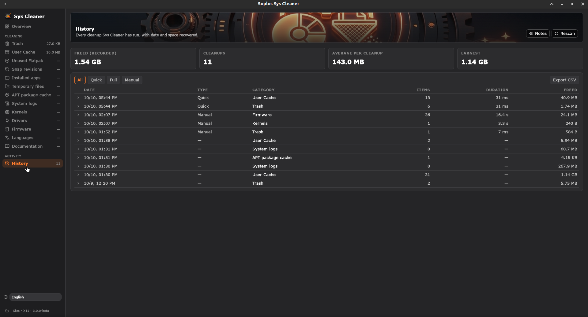

# Soplos Sys Cleaner 3.0


System cleaner and maintenance tool for Soplos Linux.

Scans the system for reclaimable space (caches, logs, temporary files, Flatpak and Snap leftovers, old kernels, unused drivers and firmware, languages and documentation you do not use), shows exactly what it found and what each item is, and only removes what you confirm.

## Screenshots

| | |
|---|---|
|  **Basic mode**: health ring, summary metrics and one standard cleanup |  **Advanced mode**: space overview by category, storage details and live system card |
|  **Languages**: locale management with regional grouping and safety risk labels |  **History**: audit receipt log for every cleanup with CSV export |

## Two programs, one package

- **Soplos Sys Cleaner** (`soplos-sys-cleaner-basic`) is the one in the applications menu: a health ring and a single standard cleanup that only touches what is safe to remove. It asks for the administrator password at most once.
- **The advanced program** (`soplos-sys-cleaner`) has every page: Overview, the cleaning pages, kernels, drivers, firmware, languages, documentation and the history. Open it from the basic program, which can also add a launcher for it to the applications menu.

Only one of them runs at a time. Both read and write the same history, so everything cleaned from one shows up in the Overview of the other.

## Architecture

Version 3.0 is a ground-up rewrite of Soplos Sys Cleaner. The original application was written in Python 3 with GTK3 (PyGObject). This version uses Tauri 2: a Rust backend and a Svelte 4 + Tailwind CSS frontend, rendered through the system's WebKitGTK.

- **Backend** (`src-tauri/`): the scanners read the system without privileges. Everything that needs root goes through one polkit-gated helper (`src-tauri/src/commands/privileged.rs`) that receives named operations, never scripts, and validates each one again as root before running it. Several operations travel in one `pkexec` call, so one password covers a whole cleanup. The action is declared in `resources/polkit/org.soplos.syscleaner.policy`.
- **Frontend** (`src/`): the advanced program (`index.html`), the basic program (`basic.html`), shared components and the 8-language dictionaries under `src/i18n/`.
- **History**: `~/.local/share/soplos-sys-cleaner/stats.json`, written atomically and shared by both programs.

## Installation

```bash
sudo apt install soplos-sys-cleaner
```

Open Soplos Sys Cleaner from the applications menu. Press F1 for the About dialog.

## Features

- Safe, Review and Protected labels on every item. Review items are never preselected and never part of the quick or full cleanup.
- A dry run (`apt-get -s`) before any package is removed, showing everything that would go with it, and blocking the cleanup if it would remove something the system needs.
- Kernels: the running kernel and the newest other kernel are always protected; kernels installed by hand are never treated as leftovers.
- Drivers and firmware: detected from the dracut configuration, PCI and USB devices, loaded modules and the kernel log. A firmware family stays protected while its driver is installed, and nothing is offered as unused if the detection tools are missing.
- Languages grouped per language, with your active language and English always kept.
- Search box (with a clear button) and sortable columns on every cleaning page, and a toolbar that stays in place while the list scrolls.
- Installed apps lists APT, Flatpak, Snap and AppImage apps (the AppImages Soplos AppImage Manager keeps in `~/AppImages`), each with its source. It exports a reinstall script: APT, Flatpak and Snap apps are installed again by command; the AppImages are listed in it with their download address, to download by hand. Base packages every installation has are left out.
- Orphaned packages: what `apt autoremove` would remove, always as Review, with a dry run first.
- Residual configuration: packages that were removed but left their configuration files (dpkg state `rc`), purged with `apt-get purge`. Always Review; the privileged side checks each one is really in that state.
- APT package cache listed file by file, so single `.deb` files can be picked. Note that the `apt` command deletes its `.deb` files after installing, while `apt-get` keeps them, so the cache is often empty after updating with `apt`.
- The health rings and the weekly chart animate from zero to their values.
- Journal retention by time or by size, with an estimate of what it frees.
- History with a receipt for every cleanup (kind, duration, command, items and result) and CSV export.
- Alerts: the user chooses when to be notified (time since the last cleanup, size ready to clean, or both) and how often to check. It only sends a desktop notification, never cleans by itself, and has no defaults: until it is turned on there is no service. It runs as a systemd user timer that is removed when turned off.
- A system card with CPU, memory, swap, GPU and temperatures, refreshed every 3 seconds.
- Light and dark themes.

## Keyboard shortcuts

| Shortcut | Action |
|---|---|
| F1 | About |
| Ctrl+Q | Quit |
| Ctrl+Tab / Ctrl+Shift+Tab | Next or previous section (advanced program) |
| F5 or Ctrl+R | Rescan |
| Ctrl+A | Select all or none (cleaning pages) |
| Ctrl+Shift+A | Select only Safe items (cleaning pages) |
| Ctrl+Enter | Clean selection (cleaning pages) |
| Ctrl+I | Show or hide the notes (advanced program) |
| Ctrl+E | Export the history as CSV |

Shortcuts do nothing while a dialog is open, and Enter alone never confirms a cleanup.

## Documentation

A Unix manual page is included and installed with the package:

```bash
man soplos-sys-cleaner
```

## Languages

The interface is available in 8 languages: English, Español, Deutsch, Français, Italiano, Português, Română and Русский. It starts in the system language and falls back to English.

## Building

```bash
npm install
npm run tauri dev      # development
./package.sh           # builds the .deb and moves it to ~/Descargas/SoplosApps
```

## License

Copyright © 2026 Sergi Perich <info@soploslinux.com>. Published under the GPL-3.0-or-later license. See `LICENSE`.
